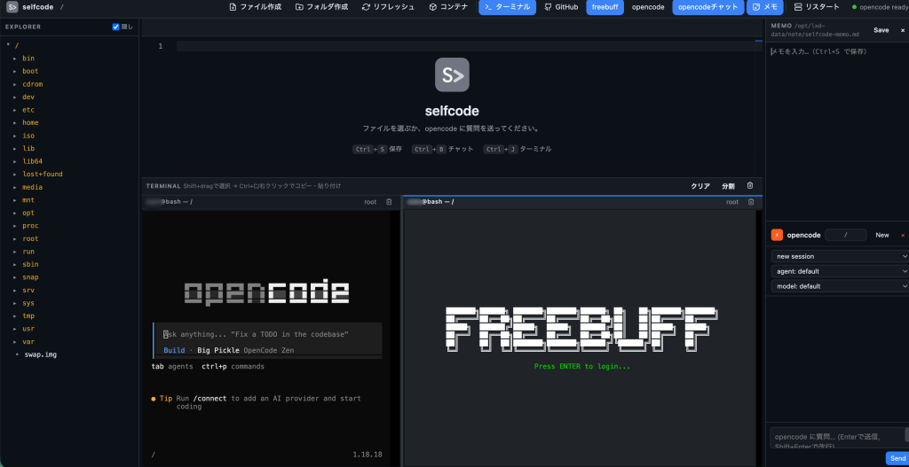
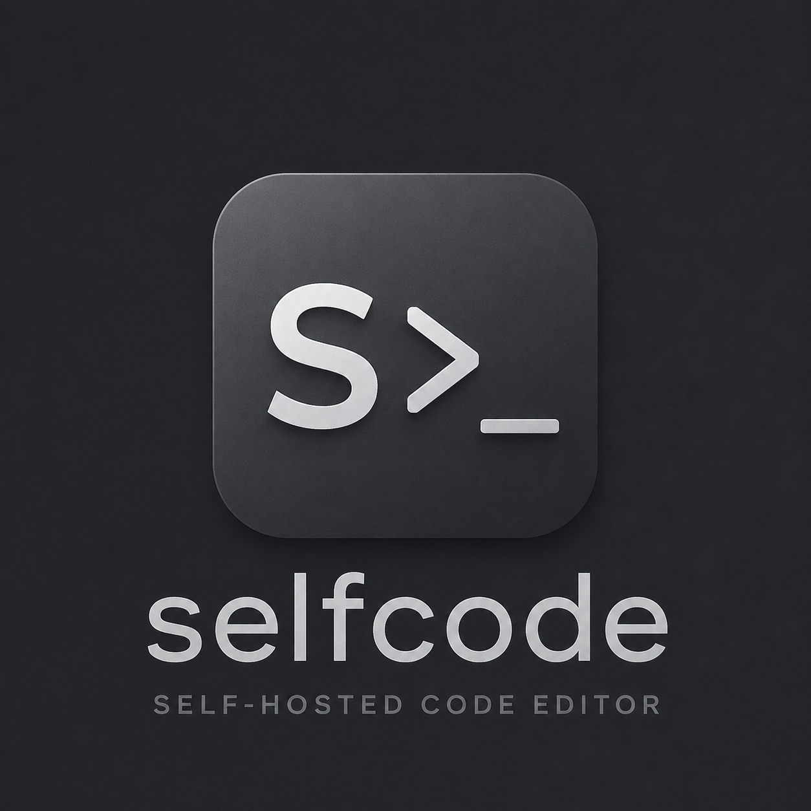

# selfcode

code-server のようにブラウザから使えて、opencode / freebuff / cline / kilo / Antigravity (agy) / GitHub Copilot CLI / Hermes などの AI エージェント連携や GitHub 連携がある、セルフホスト型コードエディタです。現在のバージョンは **v4.0.0** です。

- Monaco エディタ（VS Code と同じエディタエンジン）
- ファイルツリー / タブ編集 / 保存（Ctrl+S） / ファイル・フォルダのダウンロード（ホストは ZIP、コンテナ内は tar.gz）
- xterm.js ターミナル（**分割**・**ユーザー切替**・**リフレッシュ**対応）
- **opencode / freebuff / cline / kilo / agy (Antigravity CLI) / Copilot (GitHub Copilot CLI)** ボタンでターミナルを分割して CLI を起動（未インストールなら確認して自動インストール）。**root モード**でこれらを root 権限で起動することも可能
- **Hermes Agent パネル**：Hermes CLI の導入・Gemini API キー（GOOGLE_API_KEY）設定・起動時モデルの指定（候補から選択／直接入力、入力内容は即時保存）、およびブラウザ操作用 **CDP ブラウザ**（`http://localhost:9222`）の起動・停止。起動モードは**ヘッドレス**（Xvfb 上の専用ブラウザでデスクトップに影響しない）と**デスクトップ**（KDE セッションにウィンドウを表示。ログイン中の KDE セッションが必要）から選べます
- **一時SSH** ボタンで、agy などの OAuth 認証を手元 PC から行えるよう SSH のパスワード認証・root ログインを一時的に有効化（もう一度押すと解除）
- **通知表示**（AI設定パネル）チェックボックスで、AI ツール（opencode / freebuff / cline / kilo / agy / copilot）のタスク完了時や質問・承認確認など入力待ちの発生時に通知。ページ内トーストに加え、OS 通知（Service Worker 経由、クリックでタブへ復帰）・タブタイトルの点滅・着信音にも対応
- **beacon.sh (Agent Beacon) 連携**（AI設定パネルの beacon.sh カード）： opencode / Claude Code / Codex など 20+ ハーネスのセッションをローカルに集約する共通記憶層。状態表示・再起動・停止・再インストール・記憶フォルダを開く・オンデマンドインストールが UI から可能。コンテナ（lxc / docker exec の対象）を表示中はコンテナ内の状態を見て、「インストール」もコンテナ内に導入する（systemd が無いコンテナではサービスは「停止中」表示になるとともに、いつでもインストールできる）
- **LXD / Docker コンテナ連携**（コンテナ内のファイル操作・ターミナル）
- **GitHub 連携**（設定1/設定2 の2プロファイル対応のユーザー名・トークン保存、リポジトリのクローン登録、status / fetch / pull / ログ表示、.gitignore / AGENTS.md の作成とテンプレート編集、リモート追加・初回 push）
- **リスタート / アップデート** ボタンで UI から selfcode の再起動・最新版への更新（更新後は自動再起動、ローカル変更が原因で失敗した場合は確認のうえ強制更新も可能）
- **Tailscale serve** で Tailnet 内のみに HTTPS 公開が可能（LAN 非公開）



## インストール（GitHub から）

[GitHub リポジトリ](https://github.com/hirogura/selfcode) から、別の環境にもインストールできます。

### 自動インストール（推奨）

Ubuntu / Debian 系:

```bash
# eatmydata 経由にすると apt の .deb 展開 (node 関連パッケージ等) が大幅に速くなります
sudo apt install -y eatmydata
sudo eatmydata apt install -y git curl nodejs npm build-essential python3
curl -fsSL https://raw.githubusercontent.com/hirogura/selfcode/main/install-selfcode.sh -o /tmp/install-selfcode.sh
sudo bash /tmp/install-selfcode.sh
```

CachyOS / Arch 系（同一スクリプトで対応。`pacman` を自動判別します）:

```bash
sudo pacman -S --needed --noconfirm git curl nodejs npm base-devel python
curl -fsSL https://raw.githubusercontent.com/hirogura/selfcode/main/install-selfcode.sh -o /tmp/install-selfcode.sh
sudo bash /tmp/install-selfcode.sh
```

- 既定のインストール先は `/opt/lxd-data/selfcode`（第1引数で変更可: `sudo bash install-selfcode.sh /srv/selfcode`）
- `opencode` / `freebuff` / `cline` / `kilo` / Antigravity CLI (`agy`) / GitHub Copilot CLI (`copilot`) / `Hermes` が未導入の場合は、ターミナル上のボタンや Hermes パネルから確認のうえインストールできます（Enter または `y` で進む。スクリプト自体は CLI を導入しません）
- beacon.sh (Agent Beacon) 用のデータ置き場 `/opt/lxd-data/beacon`（`BEACON_DATA_DIR`）を自動作成し、`/etc/environment` と `selfcode.service` に永続化します。CLI 自体は「AI設定 → beacon.sh」カードからオンデマンドでインストールできます（スクリプト自体は beacon を導入しません）
- systemd サービス `selfcode.service` の登録・自動起動も行います
- **Tailscale を導入済みなら、確認のうえ `tailscale serve` で Tailnet 内のみに公開**します（完了メッセージにアクセス URL を表示）
- 確認をすべてスキップするには `-y` を付けて実行: `sudo bash install-selfcode.sh -y`

### 手動インストール

```bash
sudo mkdir -p /opt/lxd-data/selfcode
sudo git clone https://github.com/hirogura/selfcode.git /opt/lxd-data/selfcode
cd /opt/lxd-data/selfcode
sudo npm install
```

必要な CLI（未導入の場合。ターミナルから起動する際に確認プロンプトでインストールすることもできます）:

```bash
# opencode（公式インストーラ。~/.opencode/bin/opencode に導入される）
curl -fsSL https://opencode.ai/v2/install | bash

# freebuff / cline（npm グローバル。Node.js 18+ 必須）
sudo npm install -g freebuff cline

# Antigravity CLI（公式インストーラ。~/.local/bin/agy に導入される）
curl -fsSL https://antigravity.google/cli/install.sh | bash

# kilo（公式インストーラ。~/.kilo/bin または ~/.local/bin に導入される。導入後に kilo auth login）
curl -fsSL https://kilo.ai/cli/install | bash

# GitHub Copilot CLI（公式インストーラ。非 root は ~/.local/bin、root は /usr/local/bin に導入される）
curl -fsSL https://gh.io/copilot-install | bash
# 初回起動後に /login で GitHub に認証（selfcode の Copilot ボタンから起動しても可）

# Hermes Agent（公式インストーラ。~/.local/bin などに導入される）
# CDP ブラウザ用の Chromium / Xvfb も必要なら、Hermes パネルの「インストール」から導入できます
curl -fsSL https://hermes-agent.nousresearch.com/install.sh | bash

# beacon.sh（※オプション。「AI設定 → beacon.sh」カードからインストールするのが推奨。
# .deb/.rpm が systemd 環境では beacon-collector サービスまで構成される）
curl -fsSL https://github.com/asymptote-labs/agent-beacon/releases/latest/download/install.sh | bash
```

## 起動

```bash
cd /opt/lxd-data/selfcode
npm install
PORT=3339 npm start
```

ブラウザで http://localhost:3339 を開きます。

## 環境変数

| 変数 | デフォルト | 説明 |
| --- | --- | --- |
| `PORT` | `3339` | selfcode の待受ポート |
| `HOST` | `127.0.0.1` | 待受ホスト（**LAN 非公開**。Tailscale serve で公開する想定） |
| `ROOT` | `/` | 編集対象ディレクトリ（例: `ROOT=/home/user/myproject`） |
| `SELFCODE_USERNAME` / `SELFCODE_PASSWORD` | なし | 設定すると selfcode 自体に Basic 認証を付与 |
| `SELFCODE_TERM_USER` | 自動検出 | ホスト側ターミナルの既定ユーザー（例: `user`。未指定なら uid 1000 以上の実ユーザーを検出） |
| `SELFCODE_CONFIG_DIR` | `/opt/lxd-data/selfcode-config` | selfcode が自分で管理するデータ（メモ・ターミナル状態・SSH状態・GitHub設定・テンプレート・Hermes設定）の保存先ディレクトリ。`/opt/lxd-data/note` は別アプリからも見えるため v.3.0.0 から専用ディレクトリに分離。起動時に旧場所 `/opt/lxd-data/note/selfcode` のファイルを自動移行する（`SELFCODE_LEGACY_CONFIG_DIR` で旧場所を変更可） |
| `SELFCODE_LEGACY_CONFIG_DIR` | `/opt/lxd-data/note/selfcode` | 自動移行元となる旧設定ディレクトリ |
| `SELFCODE_MEMO` | `/opt/lxd-data/selfcode-config/selfcode-memo.md` | メモパネルの保存先 |
| `SELFCODE_GITHUB_CONFIG` | `/opt/lxd-data/selfcode-config/selfcode-github.json` | GitHub 連携の設定保存先（設定1/設定2 の2プロファイル分のユーザー名・トークン・登録リポジトリ・コミット設定（git config --global の user.name/user.email）と、アクティブな設定番号。設定切替時は保存済みのコミット設定を自動で gitconfig へ再適用。旧形式の単一設定は設定1に引き継ぐ。トークンはブラウザに返さずサーバー側でのみ使用） |
| `SELFCODE_TEMPLATES_CONFIG` | `/opt/lxd-data/selfcode-config/selfcode-templates.json` | GitHub パネルの「テンプレート」（`.gitignore` / `AGENTS.md` の文面）の保存先 |
| `SELFCODE_TERM_STATE` | `/opt/lxd-data/selfcode-config/selfcode-term.json` | ターミナルのペイン構成（分割・cwd・id）の保存先。別のPCから同じ selfcode を開いても同じターミナルプロセスに再接続するために使う |
| `SELFCODE_SSH_STATE` | `/opt/lxd-data/selfcode-config/selfcode-ssh.json` | 「一時SSH」の状態とバックアップした sshd 設定の保存先 |
| `SELFCODE_HERMES_CONFIG` | `/opt/lxd-data/selfcode-config/selfcode-hermes.json` | Hermes の Gemini API キー（GOOGLE_API_KEY）の保存先。平文はブラウザに返さず `hasKey` のみ返す |
| `SELFCODE_RESTART_CMD` | `systemctl restart selfcode` | 「リスタート」ボタンが実行するコマンド（Ubuntu / CachyOS ともに systemd のため共通） |
| `SELFCODE_UPDATE_TIMEOUT` | `900000`（15分） | 「アップデート」ボタンの更新処理タイムアウト（ミリ秒） |
| `SELFCODE_UPDATE_URL` | 本家 `install-selfcode.sh` の raw URL | 「アップデート」ボタンが取得するインストールスクリプトの URL（フォーク運用時のみ上書き） |
| `SELFCODE_REPO_URL` | `https://github.com/hirogura/selfcode.git` | インストールスクリプトが clone するリポジトリ（フォーク運用時のみ上書き。`SELFCODE_REPO_URL=... sudo -E bash install-selfcode.sh`） |
| `OPENCODE_BIN` | `opencode` | opencode バイナリのパス（ターミナル起動時の PATH 解決に使用） |
| `BEACON_DATA_DIR` | `/opt/lxd-data/beacon` | beacon.sh (Agent Beacon) の記憶データ置き場。ターミナルで動く AI CLI にも引き継がれる |
| `BEACON_BIN` | `beacon` | beacon CLI バイナリのパス（絶対パス指定可） |
| `BEACON_HARNESSES` | `opencode,claude,codex,cline` | beacon のエンドポイント設定で計測するハーネス（`beacon endpoint install --harness` の引数） |
| `BEACON_COLLECTOR_SERVICE` | `beacon-collector` | 「再起動」/「停止」ボタンが操作する beacon-collector サービスの名前 |

## systemd で常駐させる

1. ユニットファイルをインストール:
   ```bash
   sudo cp selfcode.service /etc/systemd/system/
   sudo systemctl daemon-reload
   ```
2. 必要に応じて `/etc/systemd/system/selfcode.service` の `Environment=` を編集
3. 起動:
   ```bash
   sudo systemctl enable --now selfcode
   ```

ログは `journalctl -u selfcode -f` で確認できます。

## Tailscale serve で公開（Tailnet 内のみ）

Tailscale を導入済みのマシンなら、selfcode を **Tailnet 内のみ**に HTTPS 公開できます（LAN には公開されません）。

```bash
# selfcode は既定で localhost のみ待受（HOST=127.0.0.1）
# ポート 3339 を Tailnet に HTTPS 公開する
# フォアグラウンドで実行されると Ctrl+C で解除されるため --bg を付ける
sudo tailscale serve --bg --https=3339 http://127.0.0.1:3339
```

- 公開後は **https://<マシンのtailnet名>:3339**（例: `https://hostname.tailnet名.ts.net:3339`）でアクセスできます
- 現在の設定確認: `tailscale serve status`
- 公開の取り消し: `sudo tailscale serve --https=3339 off`
- 証明書は Tailscale が自動発行します。`http://` でのアクセスは HTTPS サーバーが 400 を返すため、**必ず `https://` を使用**してください
- インストールスクリプトでも、Tailscale 導入済みなら確認のうえ自動設定できます

## 使い方

- 左の EXPLORER からファイルを開き、`Ctrl+S` で保存。ファイル／フォルダは右クリックから **ダウンロード**（ホストは ZIP、コンテナ内は tar.gz）できます
- 右上の **opencode** / **cline** / **kilo** / **freebuff** / **agy**（Antigravity CLI）/ **Copilot**（GitHub Copilot CLI）ボタンで、**ターミナルを分割**して新しいペインで各 CLI を起動
  - CLI が未インストールの場合は `[Y/n]` で確認（Enter または `y` で自動インストールして起動。kilo は導入後に `kilo auth login` も実行されます）
  - Copilot は導入済みならそのまま起動します。初回は起動後に `/login` と入力して GitHub に認証してください
  - **root** ボタン（root モード）を ON にすると、これらを root 権限で起動します
- 右上の **一時SSH** ボタンで、agy などの OAuth 認証を手元 PC から行えるようにする（トグル）
  - **ON**: 選択中の LXD コンテナ（未選択ならホスト）の root パスワードを `selfcode` に設定し、SSH のパスワード認証・root ログインを有効化して sshd を再起動
  - openssh-server が未導入の場合は確認を表示し、`y` で pacman（CachyOS/Arch）または apt（Debian系）から自動インストールしてから有効化
  - 手元 PC から `ssh -L <ポート>:localhost:<ポート> root@<IP>` でコンテナへポートを転送し、接続したら `agy` と入力して認証 URL を確認、手元 PC のブラウザで認証（Tailscale 利用時はマジックDNS名 `root@<ホスト名>` でも接続可能。手順は ON 時にターミナルへ案内表示）
  - 認証完了後、もう一度ボタンを押して **OFF** にすると、バックアップした sshd 設定と root パスワードを復元
- **AI設定** パネルの **通知表示** チェックボックスを ON にすると、ターミナルの AI ツール（opencode / freebuff / cline / kilo / agy / copilot）が質問・承認確認などで入力待ちになったときや実行が完了したときに、**ページ内トースト＋OS 通知**（Service Worker 経由。クリックで selfcode のタブへ戻れます）でお知らせ。タブを開いていない／他のタブを見ているときは**タブタイトルの点滅と着信音**も鳴ります（HTTPS または localhost で開いてください。通知が許可されていない場合もトースト・点滅・着信音は動作します）
- **AI設定** パネルの **beacon.sh（記憶層管理）** カードで、AI エージェントの共通記憶層 (beacon.sh / Agent Beacon) を管理
  - **状態更新**： バージョン・beacon-collector サービスの稼働状態・記憶データ置き場を表示
  - **再起動**： beacon-collector サービス（エンドポイントの常駐プロセス）を再起動
  - **停止**： beacon-collector を停止・無効化して収集をやめます（再開は「再起動」か「再インストール」）
  - **再インストール**： 導入済みでもエンドポイントの書き込み先（`--log-path`）を現在の `BEACON_DATA_DIR` で再設定します（旧環境からの移行や「停止」からの収集再開に使用）
  - **記憶フォルダを開く**: `BEACON_DATA_DIR`（既定 `/opt/lxd-data/beacon`）をエクスプローラで開く
  - **インストール**: 公式リリースから CLI を導入し、opencode / claude / codex / cline のセッション記録をローカルに収集するよう設定（進捗は同カードのログ表示に流れます）
  - ターミナルの AI ツールボタンから `beacon` を起動しようとした場合も、未導入なら確認のうえ自動インストールします
- 右上の **Hermes** ボタンで Hermes Agent パネルを開きます
  - **インストール**： Chromium / Xvfb などの依存パッケージと Hermes CLI を導入し、CDP ブラウザの起動／停止スクリプトを `~/.hermes/` に配置します（コンテナ選択中はコンテナ内に導入）
  - **Gemini APIキー**： `GOOGLE_API_KEY`（Gemini 無料枠など）を保存します。キーはサーバー側のファイルに保存され、ブラウザには返りません（「クリア」で削除）
  - **起動時のモデル**： 入力欄の候補から選択するか直接入力すると、更新のたびにブラウザ内に即時保存され、「ターミナルでHermesを起動」時に `--model <値>` として渡ります（空欄なら既定モデル）
  - **ブラウザ (CDP)**： **ヘッドレス**（Xvfb 上の専用ブラウザ。KDE セッションに影響しない）または**デスクトップ**（ログイン中の KDE セッションにウィンドウを表示）を選んで「CDPブラウザ起動」。`http://localhost:9222` で待ち受け、Hermes のブラウザ操作に使われます。終了時は「停止」（Hermes 専用プロファイルだけを停止し、既存のブラウザは残します）。開いているブラウザに CDP は後付けできないため、いずれも専用プロファイルで別起動します
  - インストールの進捗は同パネルの「ログ」に表示されます
- EXPLORER のフォルダ（またはファイル）を右クリック → **ここで freebuff** で、そのフォルダをワークスペースとして freebuff を起動
- 下の **ターミナル**（Ctrl+J）で `opencode` CLI などを実行
  - **分割**ボタンでペインを分割（フォーカス中のターミナルのフォルダを引き継ぐ）
  - 各ペインの見出しで **ユーザー切替**（root ⇔ 一般ユーザー）・**ゴミ箱**（リセットしてルートへ）・**×**（閉じる）
  - ツールバーの**ゴミ箱**でターミナル全体をリフレッシュ（全分割を解除して初期状態に戻す）
  - ターミナルのペイン構成（分割・cwd・id）はサーバー側にも保存されるため、**別のPCから同じ selfcode を開いても同じターミナルセッションに再接続**できます（code-server と同様に、そのまま作業の続きが見えます）
- ツールバーの **コンテナ** ボタンで LXD / Docker の稼働中コンテナを選択
  - エクスプローラがコンテナ内の `/` をルートに切り替わり、ファイルの閲覧・編集・アップロードが可能
  - ターミナルもコンテナ内で開きます（コンテナ内のユーザー・シェルで起動）
  - **ホストに戻る**で通常のワークスペースに戻ります
- ツールバーの **メモ** ボタンでメモパネルを開閉（Ctrl+S で保存）
- ツールバーの **GitHub** ボタンで GitHub パネルを開閉
  - **設定1 / 設定2** の2プロファイル切替に対応。GitHub ユーザー名と Personal Access Token を入力して **保存**（トークンはサーバー側のファイルに保存され、ブラウザには返りません。**接続確認** でトークンの有効性を確認できます）
  - **コミット設定**（`git config --global` の user.name / user.email）もプロファイルごとに保存され、設定切替時に自動再適用されます。**全ユーザーに適用**で root と実ユーザーの `~/.gitconfig` に同じ値を書き込めます
  - **＋ 追加** からリポジトリを **クローン** して登録（URL または `owner/repo` 形式。**自分のリポジトリから選ぶ** で一覧から選択も可能）
  - 既存フォルダ（git リポジトリ）もパスを入力して **登録** できます
  - 登録したリポジトリごとに **状態**（ブランチ・ahead/behind・変更数）、**取得**（fetch）、**pull**、**ログ**、**開く**（GitHub ページ）が使えます
  - リポジトリ内に無い場合のみ **gitignore** / **AGENTS.md** を作成できます。文面はパネル下部の **テンプレート** で編集・既定値に戻すことができます
  - リモート未設定のリポジトリには URL とブランチを指定して **初push**（`git remote add origin` → `git push -u`）ができます。pull 時にリモートが見つからない場合も、リモート設定画面から URL とブランチを指定して再実行できます
  - 登録解除（×）は登録情報だけを削除し、ローカルのファイルは削除しません
- ツールバーの **リスタート** / **アップデート** で selfcode 自身を再起動／最新版に更新できます。アップデートは公式インストールスクリプトを取得して実行し、完了後に自動再起動します（ローカルの変更で pull が失敗した場合は、確認のうえ強制更新 `--force` も可能）。`SELFCODE_UPDATE_URL` で取得元を、`SELFCODE_RESTART_CMD` で再起動コマンドを変更できます

## 構成

```
server.js            Node.js バックエンド（静的配信 / ファイルAPI / ターミナルWS / コンテナ連携 / AIエージェント連携）
public/              フロントエンド（Monaco + xterm.js + メモ・ツールバー・各AI設定パネル）
  js/app.js          メインアプリ（エディタ / ターミナル / 認証・通知 / リスタート・アップデート / Hermes パネル）
  js/github.js       GitHub パネル（リポジトリ操作・テンプレート）
  js/api.js          サーバー API ラッパー
  sw.js              Service Worker（OS 通知）
install-selfcode.sh  インストールスクリプト（GitHub から取得して導入・Tailscale serve 設定）
selfcode.service     systemd ユニットファイル（HOST=127.0.0.1 で LAN 非公開）
start.sh             systemd を使わない起動用スクリプト
```

## アンインストール

```bash
# 1. systemd サービスを停止・削除
sudo systemctl stop selfcode
sudo systemctl disable selfcode
sudo rm /etc/systemd/system/selfcode.service
sudo systemctl daemon-reload

# 2. Tailscale serve の公開を停止（設定していれば）
sudo tailscale serve --https=3339 off

# 3. インストール先を削除（保存したいデータは先に退避してください）
sudo rm -rf /opt/lxd-data/selfcode

# 4. 一緒にインストールした CLI も不要なら削除
rm -rf ~/.opencode            # opencode（~/.opencode/bin/opencode）
sudo npm uninstall -g freebuff cline
rm -f ~/.local/bin/agy         # Antigravity CLI (agy)
rm -f ~/.local/bin/copilot /usr/local/bin/copilot   # GitHub Copilot CLI (copilot)
rm -rf ~/.kilo ~/.local/bin/kilo /usr/local/bin/kilo   # kilo
rm -rf ~/.hermes ~/.local/bin/hermes /usr/local/bin/hermes   # Hermes（CDP ブラウザのプロファイル・ログも含む）
sudo apt purge beacon || sudo dnf remove beacon || sudo rpm -e beacon   # beacon.sh (systemd 環境は beacon-collector も停止)
sudo systemctl stop beacon-collector 2>/dev/null || true
rm -f ~/.local/bin/beacon /usr/local/bin/beacon; sudo rm -rf /opt/beacon   # beacon（tarball 導入の場合）
rm -rf /opt/lxd-data/beacon    # beacon の記憶データ（退避したい場合は先にコピー）
```

## 補足

- opencode のモデル設定・プロバイダ認証はホスト側の `~/.config/opencode/` を使います。
- Hermes の Gemini API キーは `SELFCODE_HERMES_CONFIG`（既定 `/opt/lxd-data/selfcode-config/selfcode-hermes.json`）に、起動時モデルと CDP ブラウザの起動モードはブラウザの `localStorage` に保存されます。CDP ブラウザは `http://localhost:9222` で待ち受け、Hermes 専用プロファイル（`~/.hermes/chrome-profile*`）で起動します。
- beacon.sh (Agent Beacon) の収集データは既定で `/opt/lxd-data/beacon`（`BEACON_DATA_DIR`）にローカル保管されます（ローカルファースト。Beacon Cloud への接続は `beacon login` / `beacon endpoint connect` を明示的に実行した場合に限ります）。
- 認証情報やデータベースなどの個人情報は `.gitignore` でリポジトリから除外されています。



## ライセンス

本プロジェクトは **MIT License** で公開されています。詳細は [LICENSE](LICENSE) を参照してください。

```
MIT License

Copyright (c) 2026 hirogura

Permission is hereby granted, free of charge, to any person obtaining a copy
of this software and associated documentation files (the "Software"), to deal
in the Software without restriction, including without limitation the rights
to use, copy, modify, merge, publish, distribute, sublicense, and/or sell
copies of the Software, and to permit persons to whom the Software is
furnished to do so, subject to the following conditions:

The above copyright notice and this permission notice shall be included in all
copies or substantial portions of the Software.

THE SOFTWARE IS PROVIDED "AS IS", WITHOUT WARRANTY OF ANY KIND, EXPRESS OR
IMPLIED, INCLUDING BUT NOT LIMITED TO THE WARRANTIES OF MERCHANTABILITY,
FITNESS FOR A PARTICULAR PURPOSE AND NONINFRINGEMENT. IN NO EVENT SHALL THE
AUTHORS OR COPYRIGHT HOLDERS BE LIABLE FOR ANY CLAIM, DAMAGES OR OTHER
LIABILITY, WHETHER IN AN ACTION OF CONTRACT, TORT OR OTHERWISE, ARISING FROM,
OUT OF OR IN CONNECTION WITH THE SOFTWARE OR THE USE OR OTHER DEALINGS IN THE
SOFTWARE.
```
